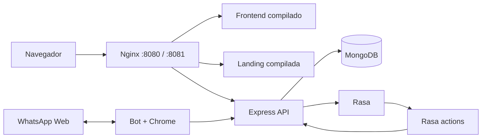

# Ejecutar LUMINA con Docker y Nginx

Para tu servidor AWS usa la [guía de Amazon Linux 2023 ARM](AWS_AL2023_ARM.md).
Las acciones instalan SDK 3.6.2 sobre Python multiarch y el bot selecciona
Chromium en ARM64 o Chrome de Puppeteer en amd64. La CI comprueba ambas arquitecturas.

Los controles de acceso vigentes, credenciales entre servicios y la restricción
del webhook de pagos se describen en [SEGURIDAD_BOT.md](SEGURIDAD_BOT.md).
La prueba `--rasa` exige ahora `SMOKE_ADMIN_TOKEN`; las consultas privadas anónimas
deben devolver 401.

Esta configuración incorpora las cinco aplicaciones del repositorio. Nginx sirve
los builds de frontend y docs; API, bot, Rasa y acciones corren en procesos separados.
MongoDB, la sesión del bot y el modelo de Rasa persisten en volúmenes nombrados.

## Inicio

Requisitos: Docker Desktop con contenedores Linux y Compose v2. Reserva al menos
6–8 GB de RAM para el conjunto; Rasa descarga una imagen grande y el primer
entrenamiento puede tardar varios minutos.

Desde la raíz:

```powershell
npm run docker:setup
npm run docker:up
```

El primer comando crea los nueve archivos `.env.production` de la tabla siguiente,
genera un JWT aleatorio para la API y no sobrescribe archivos existentes.
No requiere instalar dependencias npm en Windows: solo Node 22
para el generador. Las dependencias de ejecución se instalan dentro de las imágenes.

## Archivos de configuración

El nombre exacto es `.env.production`. Las plantillas `.env.production.example`
se versionan; los archivos reales quedan fuera de Git.

| Archivo | Uso |
| --- | --- |
| `.env.production` | Compose: nombre del proyecto, interfaz y puertos públicos |
| `apps/api/.env.production` | API: Mongo, JWT, Rasa, CORS y credenciales de integraciones |
| `apps/whatsapp-bot/.env.production` | Bot: API, checkout, sesión y modo diagnóstico |
| `apps/frontend/.env.production` | Variables públicas `VITE_*` durante el build del frontend |
| `apps/docs/.env.production` | Variables públicas durante el build de la landing; inicialmente vacío |
| `apps/rasa-chatbot/.env.production` | Rasa y su proceso de entrenamiento |
| `apps/rasa-chatbot/actions/.env.production` | Acciones de Rasa: dirección interna de la API |
| `docker/mongo/.env.production` | MongoDB |
| `docker/nginx/.env.production` | Proceso Nginx |

Los siete servicios de Compose cargan su archivo mediante `env_file`. Los dos
sitios web se compilan con Vite en modo producción, que lee el archivo de cada
aplicación. Cambiar sus variables requiere reconstruir Nginx; cambiar variables
de ejecución requiere recrear el servicio con `docker compose ... up -d`.
Un simple `restart` no actualiza las variables del contenedor.

En la primera generación se conservan los valores de la configuración antigua
`.env.docker`, si existe. Ese archivo queda como respaldo y Compose ya no lo carga.
Los `.env.production` existentes siempre tienen prioridad para el generador.
Ejecuta los comandos npm desde la raíz para cargar también las variables de Compose.

| Componente | Dirección / acceso |
| --- | --- |
| Frontend | http://localhost:8080 |
| Landing `docs` | http://localhost:8081 |
| API, a través de Nginx | http://localhost:8080/api/ |
| Swagger | http://localhost:8080/api-docs/ |
| Readiness API/Mongo | http://localhost:8080/health/ready |
| MongoDB, Rasa, actions | Solo red interna de Compose |
| Bot | Logs del contenedor; sin puerto público |



El frontend usa `/api` en el mismo origen del navegador. `http://api:3000` solo
se usa dentro de Docker. Ambas SPA tienen fallback para recargar rutas y caché
de assets con hash. Nginx vuelve a resolver el nombre de la API tras recrearla.

## WhatsApp

La vinculación local en Windows fue confirmada por el usuario (`authenticated`
y `ready`). Docker tiene **otro perfil**, guardado en `whatsapp-auth`: requiere
su propio QR. No se copia el perfil Chrome de Windows a Linux. Detén el bot local
antes de habilitar respuestas en Docker para evitar respuestas duplicadas.

El valor inicial `WA_DIAGNOSTIC=true` permite vincular sin responder mensajes:

```powershell
docker compose --env-file .env.production logs -f --tail=40 whatsapp-bot
```

Escanea el QR más reciente y espera `ready`. En `apps/whatsapp-bot/.env.production` cambia
`WA_DIAGNOSTIC=false` y recrea solo el bot:

```powershell
docker compose --env-file .env.production up -d --no-deps whatsapp-bot
```

Una única instancia por volumen/número. Hay 10 minutos para vincular y 2 minutos
para alcanzar `ready` tras autenticar. El proceso sale ante fallo; Docker permite
hasta 5 reinicios consecutivos. No se considera que esperar un QR sea un fallo
de healthcheck. El contenedor usa usuario `node`, `init`, memoria compartida de
1 GB y cierre SIGTERM; Chrome tiene `--no-sandbox` dentro de este contenedor,
sin requerir `privileged` ni acceso al socket de Docker.

## Rasa y datos

Se usan Rasa 3.6.21 y SDK 3.6.2, las versiones encontradas en el entorno local.
`rasa-train` valida y entrena antes de iniciar Rasa. Un hash de config, dominio,
datos y versión evita entrenar otra vez si nada cambió. El modelo va al volumen
`rasa-models`; el servicio Rasa lo monta en modo lectura. Al editar datos:

```powershell
docker compose --env-file .env.production up -d --build rasa-train rasa
```

La base `lumina` del volumen `mongo-data` empieza vacía. No se importan datos de
tu `.env` local ni de otra base. Registro e inicio de sesión se hacen desde la web.
El seed y los scripts administrativos existentes se deben revisar y ejecutar
explícitamente si quieres datos de demostración; no se ejecutan automáticamente.

## Culqi y Google Sheets

El stack inicia sin credenciales externas. Las operaciones Culqi requieren
`CULQI_PRIVATE_KEY`, `CULQI_SECRET` y `CULQI_PUBLIC_KEY` en `apps/api/.env.production`.
Su cliente se construye
al usar la integración, evitando que la falta de claves impida iniciar la API.
Configura también `VITE_CULQI_PUBLIC_KEY` en `apps/frontend/.env.production`.
La clave pública del checkout se incorpora en el build: después de cambiarla,
reconstruye Nginx y recrea la API:

```powershell
docker compose --env-file .env.production up -d --build api nginx
```

`LOCAL_LINK`, en los archivos de API y bot, debe ser alcanzable desde el teléfono del cliente. En otra
máquina o móvil, `localhost` apunta a ese dispositivo, no al servidor. Para probar
en LAN cambia `HTTP_BIND=0.0.0.0` en el archivo raíz, `LOCAL_LINK` en API y bot,
y `CORS_ORIGINS` en API. Si cambias puertos, actualiza también esas direcciones.

Para Google Sheets, configura `GOOGLE_SHEET_ID` y
`GOOGLE_APPLICATION_CREDENTIALS=/run/secrets/google.json` en `apps/api/.env.production`
y monta las credenciales en modo
lectura mediante un override local (no incluido en Git):

```yaml
# compose.google.yaml
services:
  api:
    volumes:
      - ./secrets/google-service-account.json:/run/secrets/google.json:ro
```

Usa `docker compose --env-file .env.production -f compose.yaml -f compose.google.yaml up -d api`.
Los archivos privados de entorno y credenciales se excluyen del contexto de build.
Solo se incluyen los `.env.production` de frontend y docs: deben contener únicamente
valores públicos. Nunca pongas tokens ni claves privadas en esos dos archivos;
las variables `VITE_*` quedan visibles en el JavaScript del navegador.

## Validación y operación

```powershell
npm run docker:validate
docker compose --env-file .env.production ps -a
node scripts/docker-smoke.cjs
node scripts/docker-smoke.cjs --rasa
npm run docker:logs
npm run docker:down
```

`docker:validate` comprueba que cada servicio cargue el archivo esperado y que
las variables resueltas coincidan con él, sin imprimir credenciales. También
comprueba las plantillas y las variables públicas de frontend/docs. CI ejecuta
esta comprobación antes del build de imágenes.

`down` conserva los volúmenes. **`down -v` borra datos, sesión y modelo**; no es un
comando de reinicio. Los logs rotan en 3 archivos de 10 MB por servicio.
Si cambias los puertos, ajusta `SMOKE_FRONTEND_URL` y `SMOKE_DOCS_URL` al ejecutar
el script de smoke.
Para probar Chrome sin vincular ni enviar mensajes:

```powershell
docker compose --env-file .env.production run --rm --no-deps whatsapp-bot node scripts/doctor.cjs --launch
```

CI valida Compose, construye todas las imágenes, valida datos Rasa y prueba
Nginx, ambas SPA y API/Mongo. No inicia el bot ni ejecuta pagos, mensajes o un
entrenamiento completo en cada PR. El lint histórico sigue siendo un check
independiente que puede fallar mientras se sanea el repositorio.

## Alcance del despliegue

Revisión de `.env.production` del 25/10/2026:

- Los siete servicios resuelven las variables desde sus archivos correspondientes.
- La generación desde plantillas funciona sin archivos previos y no sobrescribe valores.
- Compilan localmente las cuatro aplicaciones; pasan las 14 pruebas del bot.
- Se aplicó Compose con `--no-build`: los servicios web/API/Rasa quedaron saludables
  y las pruebas HTTP completas pasaron después de cargar el modelo.
- Chrome inicia en un contenedor temporal usando el entorno del bot; no se vinculó el teléfono.
- La reconstrucción de imágenes tras este cambio quedó pendiente: el permiso para
  `docker compose --env-file .env.production build` fue rechazado. El arranque anterior
  utiliza las imágenes ya disponibles; todavía falta verificar el nuevo build Docker.

Verificación local completada el 24/10/2026:

- Compilan API, frontend, docs y bot; se construyeron todas las imágenes Docker.
- Pasaron las 14 pruebas del bot y la comprobación de Chrome dentro de Linux.
- MongoDB, API, Nginx, actions y Rasa alcanzaron estado healthy.
- Se verificaron ambas SPA, rutas al recargar, assets y catálogo mediante Nginx.
- Las acciones consultaron la API por la red interna.
- Rasa validó los datos, entrenó y respondió a través de Nginx → API → Rasa.
- Un contenedor nuevo reutilizó el modelo persistido sin volver a entrenar.
- Los scripts nuevos pasan lint. El lint global histórico sigue pendiente.

Se dejaron activos los servicios web/API/Rasa. El bot se comprobó con un perfil
temporal de Chrome y no se inició su sesión de atención. `npm run docker:up`
inicia también ese servicio en modo diagnóstico para que lo vincules.
No se probaron cargos reales de Culqi, exportaciones a Google ni el QR de Docker.

La configuración predeterminada es local, con puertos ligados a `127.0.0.1`.
Para producción falta definir dominio y TLS (certificados reales o terminación
TLS aguas arriba), revisar cuentas administrativas anteriores, respaldos de Mongo
y credenciales de los proveedores. Mongo/Rasa no tienen puertos publicados.
No se ha agregado una integración con Cloud API: el bot Docker conserva el
conector WhatsApp Web que acabas de validar.
